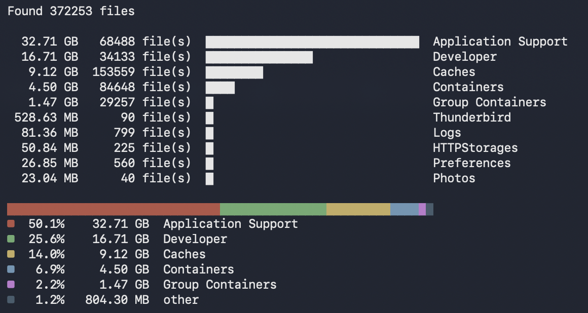

<div align="center">

# cmdcleaner

**See what is eating your disk, right from the terminal.**

Biggest files, stats by extension, folder sizes, bar charts and a pie chart.
Fast, read-only, a single binary written in Rust.

[](LICENSE)
[](https://www.rust-lang.org)
[](#installation)

</div>


<p align="center"></p>


---

## Features

- **Biggest files**: the heaviest files under any folder, sorted by size.
- **Stats by extension**: how many files of each type there are and how much space they take.
- **Folder sizes**: which subfolders weigh the most, with adjustable depth (like `du -d`).
- **Charts in the terminal**: proportional bars next to every row and a colored pie chart of the shares.
- **Read-only and safe**: cmdcleaner never deletes, moves or modifies anything.

## Installation

### With Cargo

You need [Rust](https://www.rust-lang.org/tools/install) installed.

```bash
cargo install --git https://github.com/omniex/cmdcleaner
```

This installs two commands, `cmdcleaner` and `cmdc`, into `~/.cargo/bin`.
Make sure that folder is in your `PATH`.

### From source

```bash
git clone https://github.com/omniex/cmdcleaner.git
cd cmdcleaner
cargo install --path .
```

<!--
After the first release (see the dist setup), put the one-line installers here:

macOS / Linux:
curl --proto '=https' --tlsv1.2 -LsSf https://github.com/omniex/cmdcleaner/releases/latest/download/cmdcleaner-installer.sh | sh

Homebrew:
brew install omniex/tap/cmdcleaner
-->

## Usage

```bash
cmdc [PATH] [OPTIONS]
```

`PATH` is the folder to scan and defaults to the current directory.

### Examples

```bash
# 10 biggest files in Downloads (default mode)
cmdc ~/Downloads

# Top 5 file types by total size, with a pie chart
cmdc ~/Downloads --mode types -n 5

# Which extensions have the most files?
cmdc ~/Downloads --mode types --sort count

# Folder sizes two levels deep
cmdc ~ --mode dirs --depth 2

# Plain output without bars and pie chart
cmdc ~/Downloads --mode types --no-bars --no-pie
```

### Example output

```
   4.96 GB      22 file(s)  ██████████████████████████████  mp4
   4.56 GB       8 file(s)  ███████████████████████████     dmg
   1.16 GB       2 file(s)  ██████                          mov
 375.59 MB     129 file(s)  ██                              jpg
 284.28 MB       6 file(s)  █                               dng
```

### Options

| Option | Description | Default |
|---|---|---|
| `PATH` | Folder to scan | `.` |
| `-n`, `--top <N>` | How many rows to show | `10` |
| `--mode <MODE>` | `files` (biggest files), `types` (stats by extension) or `dirs` (folder sizes) | `files` |
| `--sort <SORT>` | `size` or `count` (used by `types` and `dirs`) | `size` |
| `--depth <N>` | Folder depth for `dirs` mode | `1` |
| `--no-bars` | Hide the bar charts | bars on |
| `--no-pie` | Hide the pie chart (shown in `types` and `dirs` modes) | pie on |
| `-V`, `--version` | Print the version | |
| `-h`, `--help` | Print help | |

## Good to know

- **Read-only.** The tool only reads file metadata. Nothing is ever deleted or changed.
- **Sizes are decimal**, like in Finder on macOS (1 GB = 1000 MB), and they are the file sizes, not the disk blocks used, so numbers can differ slightly from `du`.
- **Unreadable folders are skipped.** On macOS some locations need the *Full Disk Access* permission for your terminal (System Settings, Privacy & Security). Without it the totals can be lower than the real ones.
- **Symbolic links are not followed.**
- **Progress goes to stderr**, so results can be redirected or piped without the spinner.

## Contributing

Issues and pull requests are welcome. Before opening a pull request, please run:

```bash
cargo fmt
cargo clippy
cargo test
```

## License

Released under the [MIT License](LICENSE).
